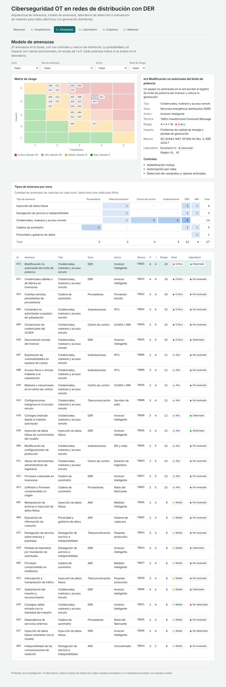

# Ciberseguridad OT en redes de distribución con DER

Herramientas para analizar la ciberseguridad de redes de distribución eléctrica con generación
distribuida (DER): arquitectura de referencia, modelo de amenazas, laboratorio de detección con
sensor pasivo e indicadores de madurez.



## Qué problema resuelve

Las distribuidoras y cooperativas suman inversores, medidores y enlaces con terceros a redes
que no fueron diseñadas con ciberseguridad. Suelen faltar tres cosas: una arquitectura clara
de quién puede hablar con quién, una lista priorizada de amenazas, y evidencia de qué ataques
se pueden detectar. Este repositorio aporta las tres, más una autoevaluación de madurez.

## Qué incluye

| Etapa | Componente | Carpeta |
|-------|------------|---------|
| 2 | Arquitectura de referencia (escenario hipotético) como datos y validador de zonas y conductos | `model/architecture.json`, `tools/validate_architecture.py` |
| 3 | Matriz preliminar refinada: 27 amenazas en 6 zonas, cruzadas con las cinco familias de la Sección 4, con ponderación provisional y MITRE ATT&CK for ICS | `model/threats.json`, `tools/risk_matrix.py` |
| 4 | Laboratorio emulado: inversor Modbus/TCP, puerto espejo, ataques y sensor pasivo | `lab/` |
| 4 | Análisis de la consulta a expertos (W de Kendall, Spearman) | `tools/expert_consensus.py` |
| 5 | Indicadores de madurez con autoevaluación | `model/maturity.json` |
| Todas | Sitio web que integra los resultados | `web/`, `docs/index.html` |

## Resultados de la última ejecución

- El sensor pasivo detectó **6 de 8** ataques ejecutados contra el inversor emulado.
- **0 alertas** en 20 segundos de operación normal (unas 400 solicitudes Modbus).
- Los dos ataques no detectados muestran los límites del monitoreo de red y por qué hace falta
  defensa en profundidad: una consigna válida enviada con la identidad del maestro autorizado (S6)
  y una inyección de datos falsos con valores físicamente posibles (S8).
- La inyección de datos falsos con valores imposibles (S7) se detecta con una regla de coherencia
  física, sin que el proceso real cambie.
- El validador encontró **3 de 15** flujos que violan la segmentación de la arquitectura de referencia.

Las capturas de cada escenario quedan en `results/pcap/` y se pueden abrir con Wireshark.

## Cómo usarlo

Requiere Python 3.10 o superior. No tiene dependencias externas.

```bash
python tools/validate_architecture.py   # Etapa 2: valida los flujos
python tools/risk_matrix.py             # Etapa 3: calcula la matriz de riesgo
python -m lab.run_lab                   # Etapa 4: ejecuta el laboratorio (unos 30 s)
python -m lab.live                      # Etapa 4: laboratorio en tiempo real con panel web
python tools/expert_consensus.py        # Etapa 4: analiza la consulta a expertos
python web/build.py                     # Genera docs/index.html
python -m unittest                      # Pruebas
```

Para ver el sitio sin el laboratorio en vivo, abrir `docs/index.html` en el navegador. Para
publicarlo, activar GitHub Pages sobre la carpeta `docs/`.

## Cómo funciona el laboratorio

```
pasarela emulada ─┐
                  ├──► switch emulado ──► inversor emulado (Modbus/TCP)
equipo atacante ──┘         │
                            └──► copia a PCAP ──► sensor pasivo ──► alertas
```

- `lab/inverter_sim.py`: inversor con registros de potencia, límite de potencia y conexión.
- `lab/tap.py`: switch con puerto espejo. Cada puerto de entrada tiene la dirección IP del
  equipo que representa.
- `lab/run_lab.py`: ejecuta la operación normal y ocho ataques, incluido un intermediario que altera
  la telemetría en tránsito.
- `lab/detector.py`: motor de ocho reglas que procesa un paquete por vez, desde un PCAP o en vivo. No envía paquetes.
- `lab/policy.json`: maestros autorizados y límites de ingeniería.

| Regla | Detecta | Técnica |
|-------|---------|---------|
| R1 | Maestro Modbus no autorizado | T0846 |
| R2 | Escritura desde un maestro no autorizado | T0855 |
| R3 | Consigna fuera de los límites de ingeniería | T0836 |
| R4 | Orden de desconexión del inversor | T0816 |
| R5 | Solicitud de identificación o diagnóstico | T0888 |
| R6 | Barrido de registros | T0846 |
| R7 | Tasa de solicitudes anómala | T0814 |
| R8 | Telemetría físicamente incoherente (potencia imposible para el límite y el estado) | T0856 |

## Laboratorio en tiempo real

```bash
python -m lab.live
```

Abre el sitio completo en `http://127.0.0.1:8765`, en la pestaña **En vivo**. El switch emulado entrega cada paquete al sensor en
el momento en que pasa, y el panel muestra el estado del inversor, la tasa de solicitudes y
las alertas al instante. Desde el panel se lanza cada ataque y se ve su efecto sobre la
potencia del inversor y la alerta que genera. El gráfico compara la potencia real con la
reportada al centro de control, que solo difieren durante una inyección de datos falsos. Se corta con Ctrl+C.


- `lab/live.py`: laboratorio continuo y servidor local (solo escucha en `127.0.0.1`).
- La pestaña En vivo del sitio recibe los eventos por Server-Sent Events. Sin el servidor local
  (por ejemplo en GitHub Pages) muestra el comando para iniciarlo.
- En este modo una misma alerta puede repetirse después de 3 segundos.

## Cómo adaptarlo

1. Reemplazar `model/architecture.json` con las zonas, activos, conductos y flujos relevados.
2. Reemplazar `model/threats.json` con la matriz de amenazas propia.
3. Reemplazar `model/experts_sample.csv` con las respuestas reales (una fila por experto).
4. Ajustar `lab/policy.json` y agregar escenarios en `lab/run_lab.py`.
5. Ejecutar el laboratorio y regenerar el sitio.

## Relación con el trabajo de investigación

Este repositorio es el prototipo de las etapas futuras del trabajo *Ciberseguridad en Redes
Eléctricas Inteligentes con Generación Distribuida: Revisión Estructurada y Matriz de Controles
para Entornos IT/OT* (CONAIISI 2026), orientado a redes de distribución con DER en localidades
del interior de la provincia de Santa Fe, Argentina.

| Etapa de la hoja de ruta | Componente del repositorio |
|---|---|
| 2. Arquitectura de referencia | `model/architecture.json`, `tools/validate_architecture.py` |
| 3. Modelo de amenazas | `model/threats.json`, `tools/risk_matrix.py` |
| 4. Evaluación por emulación y consulta a especialistas | `lab/`, `tools/expert_consensus.py` |
| 5. Indicadores de madurez | `model/maturity.json` |

**Qué proviene del trabajo**

- Las seis zonas (Sección 3): AMI, automatización de subestaciones, centro de control,
  telecomunicación y pasarelas, DER, y proveedores.
- Las amenazas, impactos, controles y marcos de cada zona (Tabla 1).
- Las cinco familias de amenazas (Sección 4).

**Qué agrega el prototipo y está pendiente de validación**

- La zona de TI corporativa, incluida solo como contexto de la convergencia IT/OT.
- Los activos, direcciones, conductos y flujos de la arquitectura, que son un escenario hipotético.
- La probabilidad y el impacto de cada amenaza: la matriz del trabajo no pondera.
- La técnica de MITRE ATT&CK for ICS de cada amenaza.
- La asignación de cada amenaza a una familia.
- Las amenazas A26 y A27, que extienden a DER la inyección de datos falsos que la Tabla 1 nombra en AMI.

Cada amenaza de `model/threats.json` indica su origen en el campo `source`.

## Limitaciones

- La arquitectura es un escenario hipotético: activos, direcciones, conductos y flujos no describen un despliegue real.
- La matriz del trabajo no pondera probabilidad ni severidad. Los valores de riesgo y las técnicas de ATT&CK son una propuesta provisional, pendiente de validación.
- El laboratorio evalúa 8 de las 27 amenazas, todas de la zona DER.
- Las dos amenazas de datos falsos en DER (A26 y A27) extienden la Tabla 1, que nombra esa amenaza en AMI.
- La asignación de cada amenaza a una familia de la Sección 4 es una propuesta del prototipo.
- La regla de coherencia usa la relación simplificada del emulador entre potencia, límite y conexión.
- Las respuestas de expertos de `experts_sample.csv` son sintéticas.
- El laboratorio emula solo Modbus/TCP. No cubre IEC 60870-5-104, DNP3 ni IEC 61850.
- El mapa de registros del inversor es simplificado y no corresponde a un equipo real.
- La emulación valida la lógica de detección. No reemplaza pruebas con equipos reales.
- Los indicadores de madurez son orientativos, inspirados en C2M2 y NIST CSF 2.0.

## Uso responsable

Los escenarios de ataque solo se conectan a `127.0.0.1`, contra el inversor emulado de este
laboratorio. No usar contra equipos o redes sin autorización.
