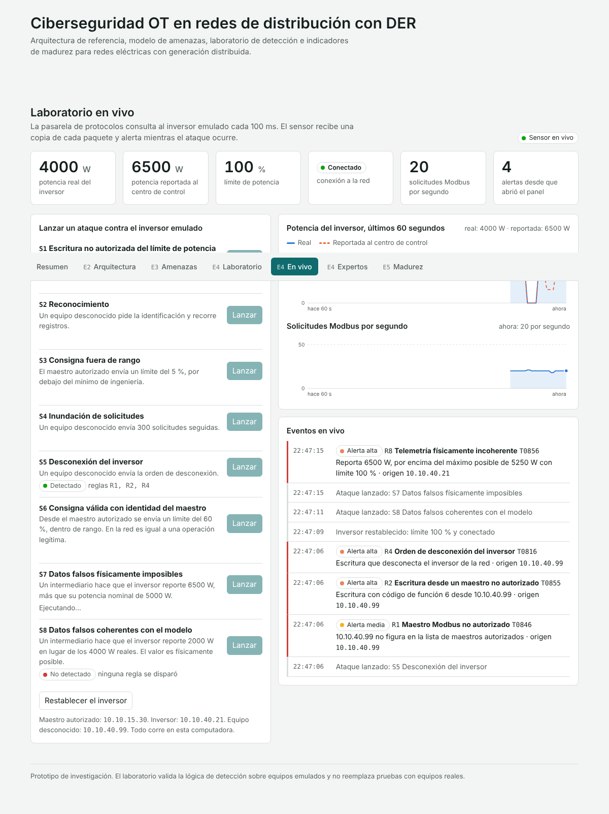
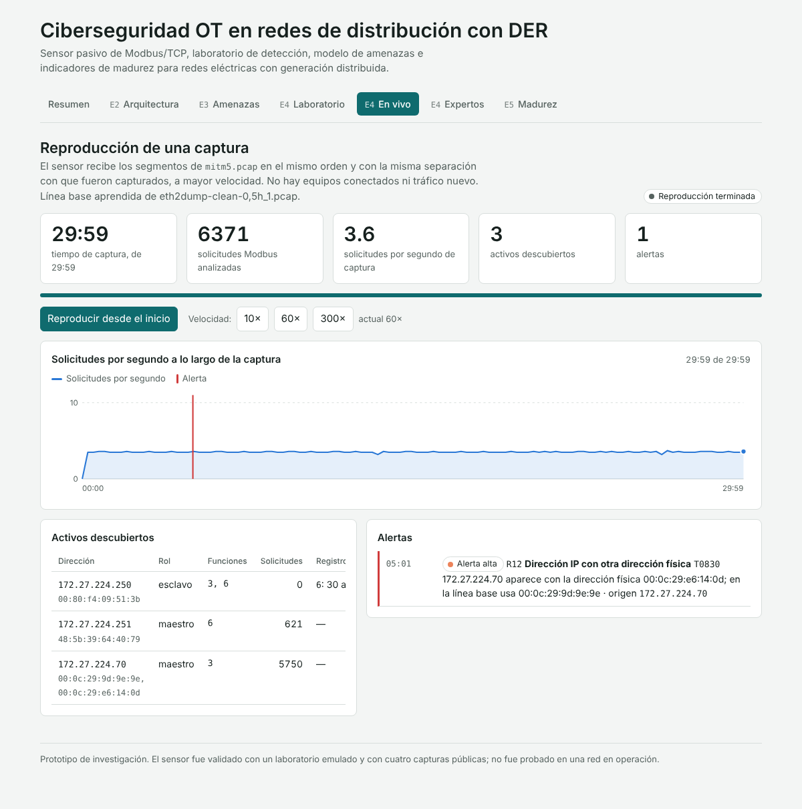

# Ciberseguridad OT en redes de distribución con DER

Sensor pasivo de Modbus/TCP para redes eléctricas con generación distribuida (DER), con un
laboratorio que lo pone a prueba y un modelo de arquitectura, amenazas y madurez que le da contexto.



## Qué problema resuelve

Las distribuidoras y cooperativas suman inversores, medidores y enlaces con terceros a redes que
no fueron diseñadas con ciberseguridad. Modbus/TCP, el protocolo habitual de los inversores, no
autentica a quien envía una orden. Hace falta saber qué equipos hay en la red, quién le habla a
quién, y enterarse cuando alguien que no debe cambia una consigna o desconecta un inversor, sin
agregar tráfico a una red que no lo tolera.

## Qué incluye

| Componente | Qué hace | Carpeta |
|---|---|---|
| **Sensor pasivo** | Lee una captura o una interfaz de red, arma el inventario de activos, aprende una línea base y alerta ante desvíos. Nunca transmite | `sensor/` |
| **Laboratorio** | Emula un inversor, una pasarela y un atacante; ejecuta 8 ataques y mide qué detecta el sensor, grabado o en tiempo real | `lab/` |
| **Arquitectura de referencia** | Zonas, activos y conductos como datos, con un validador de segmentación | `model/architecture.json`, `tools/validate_architecture.py` |
| **Modelo de amenazas** | 27 amenazas por zona y por tipo, con controles, marcos y MITRE ATT&CK for ICS | `model/threats.json`, `tools/risk_matrix.py` |
| **Consulta a expertos** | Acuerdo entre expertos (W de Kendall, Spearman) | `tools/expert_consensus.py` |
| **Indicadores de madurez** | Autoevaluación de 18 preguntas | `model/maturity.json` |
| **Sitio** | Reúne todo, con una pestaña en vivo | `web/`, `docs/index.html` |

Requiere Python 3.10 o superior. No tiene dependencias externas, salvo scapy para capturar en
vivo fuera de Linux.

## El sensor

Funciona sobre cualquier captura PCAP o PCAPNG de Modbus/TCP, no solo sobre las del laboratorio.

```bash
# 1. Inventario y reglas básicas, sin configurar nada
python -m sensor analyze captura.pcap

# 2. Aprender la línea base de un período de operación normal
python -m sensor learn normal.pcap -o linea_base.json

# 3. Analizar otra captura contra esa línea base
python -m sensor analyze captura.pcap --policy linea_base.json --json resultado.json

# 4. Escuchar una interfaz conectada a un puerto espejo
sudo python -m sensor live --iface eth0 --policy linea_base.json
```

`analyze` termina con código 1 si hubo alertas, para poder usarlo en scripts.

**Qué entrega**

- **Inventario:** cada equipo con su rol (maestro o esclavo), identificación si la anuncia, funciones
  Modbus usadas, registros escritos con sus rangos, excepciones y ritmo de solicitudes.
- **Línea base:** maestros autorizados, funciones aceptadas por cada esclavo, rangos de escritura
  y límite de tasa, en un JSON legible que conviene revisar antes de usar.
- **Direcciones físicas:** la dirección MAC con la que aparece cada IP, para detectar suplantaciones.
- **Alertas:** cada una con su regla, severidad, técnica de MITRE ATT&CK for ICS y origen.

| Regla | Detecta | Técnica | Necesita |
|---|---|---|---|
| R1 | Maestro Modbus no autorizado | T0846 | Lista de maestros |
| R2 | Escritura desde un maestro no autorizado | T0855 | Lista de maestros |
| R3 | Consigna fuera de los límites | T0836 | Límites manuales o aprendidos |
| R4 | Orden de desconexión del inversor | T0816 | Registro de conexión |
| R5 | Solicitud de identificación o diagnóstico | T0888 | Nada |
| R6 | Barrido de registros | T0846 | Nada |
| R7 | Tasa de solicitudes anómala | T0814 | Límite de tasa |
| R8 | Telemetría físicamente incoherente | T0856 | Modelo del equipo |
| R9 | Código de función ausente en la línea base | T0855 | Línea base |
| R10 | Escritura a un registro sin antecedentes | T0836 | Línea base |
| R11 | Esclavo ausente en la línea base | T0846 | Línea base |
| R12 | Dirección IP que aparece con otra dirección física (suplantación ARP) | T0830 | Nada |

**Por qué es seguro para una red industrial:** el paquete `sensor/` no contiene código capaz de
transmitir, y una prueba automática lo verifica. Se conecta a un puerto espejo o a un TAP; si el
sensor falla, la operación sigue igual.

**Qué soporta el lector de capturas:** PCAP y PCAPNG; Ethernet con etiquetas VLAN, Linux cooked,
IP sin encapsular y loopback; IPv4 e IPv6; descarte de retransmisiones y duplicados TCP.

## Validación con capturas de terceros

El sensor se probó sobre capturas públicas que no generó este proyecto: el *Cyber-security Modbus
ICS dataset* de la Universidad de Coimbra, tomado en un banco de pruebas con equipos reales. La
línea base se aprendió de la captura de operación normal y se aplicó a las de ataque.

| Captura (30 minutos cada una) | Contenido | Resultado | Primera alerta |
|---|---|---|---|
| `eth2dump-clean-0,5h_1.pcap` | Operación normal | Sin alertas | — |
| `eth2dump-mitm-change-5m-0,5h_1.pcap` | Intermediario por suplantación ARP, 5 minutos | Detectado: R12 | Segundo 301 |
| `eth2dump-mitm-change-15m-0,5h_1.pcap` | Intermediario por suplantación ARP, 15 minutos | Detectado: R12 | Segundo 301 |
| `eth2dump-modbusQueryFlooding1m-0,5h_1.pcap` | Inundación de consultas Modbus, 1 minuto | Detectado: R1, R2, R3, R7 | Segundo 299 |

- En las tres capturas de ataque no hubo ninguna alerta durante los cinco minutos previos al
  ataque, que son tráfico normal distinto del usado para aprender.
- El sensor armó solo el inventario: un controlador y dos maestros, con sus direcciones físicas,
  funciones y el único registro que se escribe, con valores de 30 a 31.
- **Esta prueba encontró un punto ciego.** La primera versión del sensor no veía el intermediario,
  porque la suplantación ARP no cambia direcciones IP ni contenido Modbus reconocible. De ahí
  salió la regla R12, que mira la capa de enlace.
- R12 detecta la presencia del intermediario, no qué valores alteró.
- Sin línea base, R12 detecta igual al intermediario; la inundación necesita la línea base.

Para repetirla, descargar `captures1_v2.zip` del conjunto de datos y ejecutar:

```bash
python -m sensor learn   clean/eth2dump-clean-0,5h_1.pcap -o base.json
python -m sensor analyze mitm/eth2dump-mitm-change-5m-0,5h_1.pcap --policy base.json
python -m sensor analyze modbusQueryFlooding/eth2dump-modbusQueryFlooding1m-0,5h_1.pcap --policy base.json
```

Las capturas no se incluyen en este repositorio. Fuente: I. Frazão, P. H. Abreu, T. Cruz,
H. Araújo y P. Simões, "Denial of Service Attacks: Detecting the Frailties of Machine Learning
Algorithms in the Classification Process", CRITIS 2018, doi:10.1007/978-3-030-05849-4_19.
Conjunto de datos: https://github.com/tjcruz-dei/ICS_PCAPS

## Reproducción de capturas en vivo

El panel web puede reproducir una captura grabada respetando sus tiempos, para ver al sensor
trabajar sobre tráfico de equipos reales: el inventario se arma solo, el gráfico avanza y las
alertas aparecen en el momento de la captura en que ocurre el ataque.

```bash
# Con las capturas del laboratorio, incluidas en el repositorio
python -m lab.live --replay results/pcap/S5.pcap --policy lab/policy.json --speed 1

# Con capturas de terceros: aprende la línea base de la captura normal y reproduce la de ataque
python -m lab.live --replay mitm/eth2dump-mitm-change-5m-0,5h_1.pcap --baseline clean/eth2dump-clean-0,5h_1.pcap
```



Sin `--speed`, elige la velocidad que hace durar la reproducción unos 45 segundos. Es una
reproducción: no hay equipos conectados ni tráfico nuevo.

**En el sitio publicado**, la pestaña En vivo trae dos reproducciones grabadas, del intermediario
y de la inundación del conjunto de datos de Coimbra, que se ven sin instalar nada. Guardan lo que
el sensor fue observando (solicitudes, activos y alertas a lo largo del tiempo), no el tráfico.
Para grabar otra captura:

```bash
python tools/record_replay.py ataque.pcap --baseline normal.pcap --title "Título" --description "Qué muestra"
python web/build.py
```

## El laboratorio

```
pasarela emulada ─┐
                  ├──► switch emulado ──► inversor emulado (Modbus/TCP)
equipo atacante ──┘         │
                            └──► puerto espejo ──► sensor ──► alertas
```

```bash
python -m lab.run_lab     # ejecuta los 8 ataques y guarda capturas y resultados (unos 35 s)
python -m lab.live        # lo mismo en tiempo real, con panel web en http://127.0.0.1:8765
```

Resultados de la última ejecución:

| Escenario | Ataque | Política manual | Línea base aprendida |
|---|---|---|---|
| S1 | Escritura no autorizada del límite de potencia | Detectado | Detectado |
| S2 | Reconocimiento | Detectado | Detectado |
| S3 | Consigna fuera de rango desde el maestro autorizado | Detectado | Detectado |
| S4 | Inundación de solicitudes | Detectado | Detectado |
| S5 | Desconexión del inversor | Detectado | Detectado |
| S6 | Consigna válida con identidad del maestro | No detectado | Detectado |
| S7 | Datos falsos físicamente imposibles | Detectado | No detectado |
| S8 | Datos falsos coherentes con el modelo | No detectado | No detectado |

- **0 alertas** en 20 segundos de operación normal (unas 400 solicitudes), con ambas políticas.
- Las dos políticas se complementan. La línea base detecta S6 porque en la operación normal
  nadie escribe; si las escrituras fueran habituales, una consigna dentro de rango pasaría. La
  coherencia física (S7) solo existe en la política manual, porque requiere el modelo del equipo.
- S8 no se detecta de ninguna forma: un dato falso físicamente posible es indistinguible en la
  red. Es el motivo para sumar autenticación y contraste con otras fuentes de medición.

Las capturas de cada escenario quedan en `results/pcap/` y se abren con Wireshark.

Con el servidor en marcha, el sitio abre en la pestaña **En vivo**: se lanza cada ataque y se ve
su efecto y su alerta al instante. El gráfico compara la potencia real con la reportada al centro
de control, que solo difieren durante una inyección de datos falsos. Sin el servidor (por ejemplo
en GitHub Pages) esa pestaña muestra las reproducciones grabadas.

## El modelo

```bash
python tools/validate_architecture.py   # flujos que violan la segmentación
python tools/risk_matrix.py             # matriz de riesgo
python tools/expert_consensus.py        # acuerdo entre expertos
python web/build.py                     # regenera docs/index.html
```

El validador encuentra 3 de 15 flujos que violan la segmentación de la arquitectura de referencia.
Para ver el sitio sin el laboratorio en vivo, abrir `docs/index.html`. Para publicarlo, activar
GitHub Pages sobre la carpeta `docs/`.

## Pruebas

```bash
python -m unittest
```

26 pruebas: modelo, laboratorio grabado y en vivo, reproducción, lector de capturas, línea base y
línea de comandos. El historial de versiones está en `CHANGELOG.md`.

## Cómo adaptarlo

1. Reemplazar `model/architecture.json` y `model/threats.json` con la arquitectura y las amenazas propias.
2. Reemplazar `model/experts_sample.csv` con las respuestas reales (una fila por experto).
3. Para una red propia: capturar tráfico normal, ejecutar `python -m sensor learn`, revisar la
   línea base y agregarle a mano los límites de ingeniería y, si se conoce el equipo, la sección
   `coherence` (ver `lab/policy.json`).

## Relación con el trabajo de investigación

Este repositorio es el prototipo de las etapas futuras del trabajo *Ciberseguridad en Redes
Eléctricas Inteligentes con Generación Distribuida: Revisión Estructurada y Matriz de Controles
para Entornos IT/OT* (CONAIISI 2026), orientado a redes de distribución con DER en localidades
del interior de la provincia de Santa Fe, Argentina.

**Artículo completo:** [paper/pignatelli-casco-roatta-2026-ciberseguridad-smart-grids-der.pdf](paper/pignatelli-casco-roatta-2026-ciberseguridad-smart-grids-der.pdf)

> U. G. Pignatelli, M. E. Casco y S. Roatta, "Ciberseguridad en Redes Eléctricas Inteligentes con
> Generación Distribuida: Revisión Estructurada y Matriz de Controles para Entornos IT/OT",
> 14° Congreso Nacional de Ingeniería en Informática / Sistemas de Información (CONAIISI 2026),
> Resistencia, Chaco, Argentina, noviembre de 2026.

El artículo presenta la etapa inicial de la investigación: la revisión estructurada y la matriz
preliminar de trazabilidad. Este repositorio no forma parte de sus resultados; desarrolla lo que
el artículo define como etapas futuras.

| Etapa de la hoja de ruta | Componente del repositorio |
|---|---|
| 2. Arquitectura de referencia | `model/architecture.json`, `tools/validate_architecture.py` |
| 3. Modelo de amenazas | `model/threats.json`, `tools/risk_matrix.py` |
| 4. Evaluación por emulación y consulta a especialistas | `sensor/`, `lab/`, `tools/expert_consensus.py` |
| 5. Indicadores de madurez | `model/maturity.json` |

**Qué proviene del trabajo**

- Las seis zonas (Sección 3): AMI, automatización de subestaciones, centro de control,
  telecomunicación y pasarelas, DER, y proveedores.
- Las amenazas, impactos, controles y marcos de cada zona (Tabla 1).
- Las cinco familias de amenazas (Sección 4).

**Qué agrega el prototipo y está pendiente de validación**

- La zona de TI corporativa, incluida solo como contexto de la convergencia IT/OT.
- Los activos, direcciones, conductos y flujos de la arquitectura, que son un escenario hipotético.
- La probabilidad y el impacto de cada amenaza: la matriz del trabajo no pondera.
- La técnica de MITRE ATT&CK for ICS de cada amenaza.
- La asignación de cada amenaza a una familia.
- Las amenazas A26 y A27, que extienden a DER la inyección de datos falsos que la Tabla 1 nombra en AMI.

Cada amenaza de `model/threats.json` indica su origen en el campo `source`.

## Limitaciones

- **El sensor solo entiende Modbus/TCP.** No decodifica IEC 60870-5-104, DNP3 ni IEC 61850.
- **La validación externa es acotada:** cuatro capturas de un único conjunto de datos público. No
  se probó en una red en operación ni con otros fabricantes.
- **R12 da falsos positivos previsibles** al reemplazar un equipo o con protocolos de redundancia
  que comparten una dirección IP entre dos equipos.
- **La captura en vivo se probó en Linux.** La variante para Windows (scapy y Npcap) no está probada.
- **El lector no reordena segmentos TCP** que llegan fuera de orden ni reensambla fragmentos IP.
- **La línea base acepta como normal todo lo que observa.** Aprenderla de un período con un
  incidente en curso lo deja autorizado.
- **La regla de coherencia** usa la relación simplificada del emulador entre potencia, límite y
  conexión; en un inversor real la potencia depende también de la irradiancia.
- **El laboratorio evalúa 8 de las 27 amenazas**, todas de la zona DER, y su mapa de registros no
  corresponde a un equipo real.
- La arquitectura es un escenario hipotético, las ponderaciones de riesgo son provisionales y las
  respuestas de expertos de `experts_sample.csv` son sintéticas.
- Los indicadores de madurez son orientativos, inspirados en C2M2 y NIST CSF 2.0.

## Uso responsable

El sensor es pasivo y puede usarse sobre capturas o redes propias, o con autorización de quien las
opera. Los escenarios de ataque del laboratorio solo se conectan a `127.0.0.1`, contra el inversor
emulado. No usar contra equipos o redes sin autorización.
